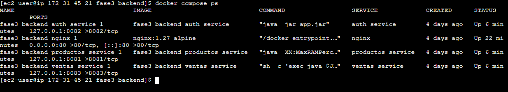
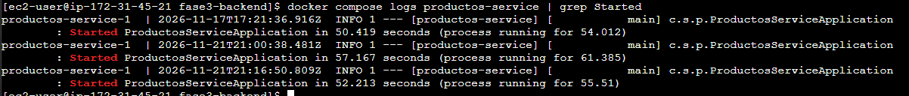
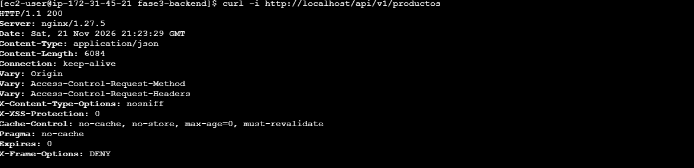
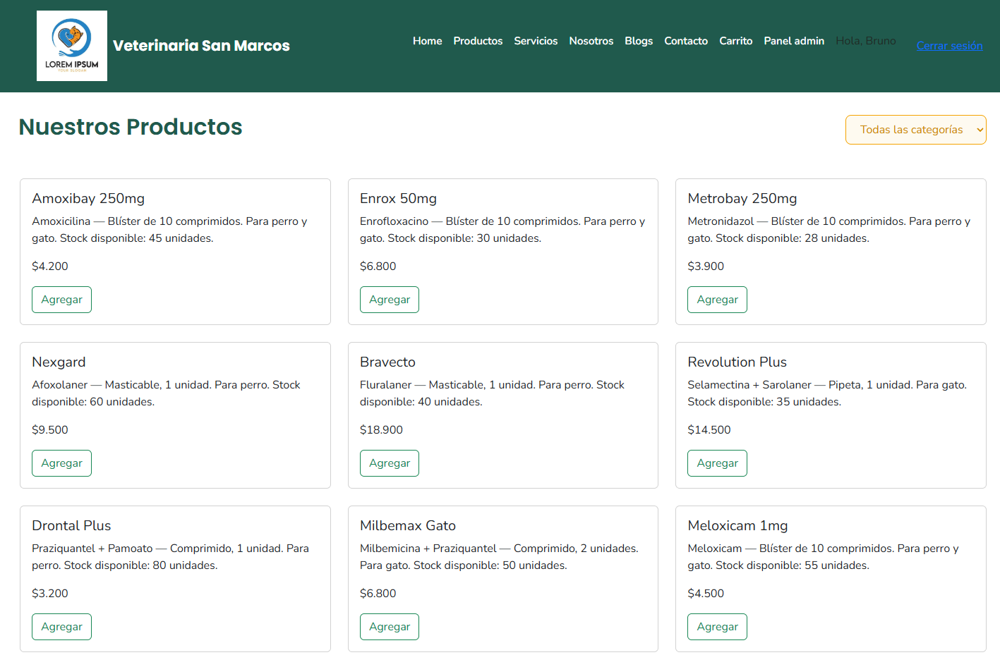
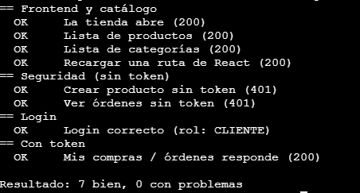

# Evidencia de despliegue en AWS

Veterinaria San Marcos: frontend React y tres microservicios Spring Boot desplegados con Docker Compose en una instancia EC2, con Nginx como punto de entrada y Oracle Autonomous Database como base de datos.

## Arquitectura

```
Navegador ──► Nginx (puerto 80) ──┬─► productos-service (8081)
                                  ├─► auth-service      (8082)
                                  └─► ventas-service    (8083) ──► Oracle Autonomous DB (wallet mTLS)
```

- Nginx sirve el frontend compilado y redirige `/api/v1/...` a cada servicio. Su configuración está en [`fase3-backend/nginx/default.conf`](../../fase3-backend/nginx/default.conf).
- Los tres servicios se definen en [`fase3-backend/docker-compose.yml`](../../fase3-backend/docker-compose.yml). Los puertos 8081 a 8083 quedan solo en `127.0.0.1`; desde internet únicamente se llega por Nginx.
- Las claves (`.env`), la wallet de Oracle y la llave `.pem` **no están en el repositorio**.

## Paso a paso

1. **Servidor.** Instancia EC2 con Docker y Docker Compose instalados, e IP elástica asociada.
2. **Base de datos.** Autonomous Database con lista de acceso (ACL) que permite la IP del servidor. La wallet se copia a `/opt/wallet` y se monta en solo lectura en los contenedores.
3. **Variables.** Archivo `.env` en el servidor con `DB_SERVICIO`, `DB_USER`, `DB_PASSWORD`, `JWT_SECRET`, `CORS_ORIGINS` y las del primer administrador. Los tres servicios comparten el mismo `JWT_SECRET`.
4. **Imágenes.** `docker compose build` construye las tres imágenes (Maven multietapa, Java 21).
5. **Frontend.** `npm run build` en `fase2-react`, y el contenido de `dist/` se copia a `fase3-backend/frontend/`.
6. **Arranque.** `docker compose up -d`.
7. **Verificación.** `docker compose ps`, logs de cada servicio y `prueba-humo.sh`.

Para actualizar el servidor después de nuevos cambios se usa [`fase3-backend/actualizar.sh`](../../fase3-backend/actualizar.sh).

## Resultado

> Las capturas se agregan en esta misma carpeta con estos nombres.

### Servicios en ejecución


### Arranque del microservicio de productos


### API respondiendo a través de Nginx


### Aplicación funcionando en el navegador


### Prueba de humo


## Notas

- Las capturas ocultan la IP pública del servidor.
- Orden de despliegue de la base de datos: ACL con la IP del servidor, wallet descargada de la misma base y alias `DB_SERVICIO` presente en su `tnsnames.ora`.
